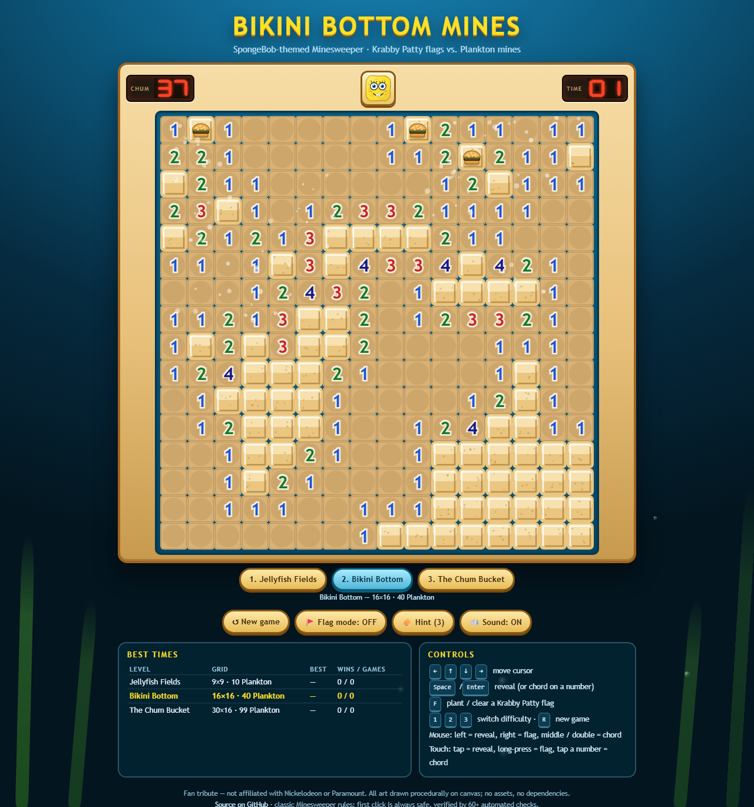
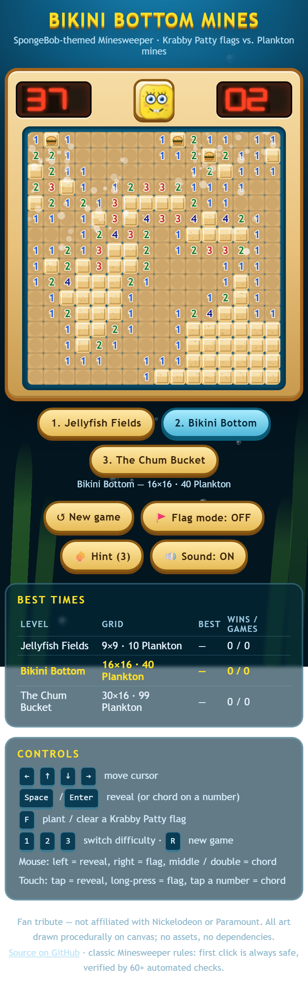

# 🧽 Bikini Bottom Mines

**A SpongeBob-themed Minesweeper — real Minesweeper rules, hand-drawn canvas art, synthesized audio, one HTML file, zero dependencies.**

[**▶ Play it live**](https://nwfella.github.io/spongebob-minesweeper/) · [Source](https://github.com/nwfella/spongebob-minesweeper)



Mines are Plankton. Flags are Krabby Patties. The new-game button is SpongeBob's
face, and it reacts to what you do.

---

## How to play

| | |
|---|---|
| **Goal** | Uncover every tile that isn't Plankton |
| **First click** | Always safe — it always opens a region |
| **Reveal** | Left-click / tap |
| **Flag** | Right-click / long-press (or turn on Flag mode) |
| **Chord** | Double-click, middle-click, or tap an open number with matching flags |
| **Keyboard** | Arrows move · `Space`/`Enter` reveal or chord · `F` flag · `1`–`3` level · `R` restart |

**Levels:** Jellyfish Fields 9×9 / 10 · Bikini Bottom 16×16 / 40 · The Chum Bucket 30×16 / 99.
Best time and win/loss counts are stored per level in `localStorage`.

---

## What it demonstrates

**Faithful game logic, not a lookalike.** Mines are placed *after* the first click,
excluding the clicked tile **and its eight neighbours** — so the first click is
guaranteed safe and guaranteed to be a zero, which means the flood fill always
opens a region. Chording detonates on a wrong flag, exactly like the original.
The flag cycles flag → question → clear, and a planted flag blocks the flood fill.
The mine counter is allowed to go negative. The timer starts on the first uncover
and freezes on win or loss.

**Everything is drawn from code.** No images, no fonts, no network requests. The
tiles, the wobbly sponge silhouette with its pores and freckles, Plankton's single
eye and antennae, the Krabby Patty's sesame bun and lettuce frill, and the 7-segment
LED counters are all canvas 2D primitives. The face button has five moods
(`ready` / `press` / `win` / `lose` / `freeze`).

**Rendering that doesn't fight the frame budget.** Tiles rasterise once into an
offscreen cache invalidated by a dirty flag; each frame composites cache → cursor →
particles → win flash. The rAF loop touches the DOM only when a counter value
actually changes.

**Audio without asset loading.** Web Audio synthesis for every cue — a pop that
pitches with the revealed number, a bubbly sweep for a flood open, a two-tone flag
ding, a noise-burst explosion, Plankton's four-note laugh, a five-note win
arpeggio. All tones are scheduled on `audioCtx.currentTime`, so multi-note cues
never jitter the main thread.

**Deterministic by construction.** A seeded `mulberry32` RNG means any board can be
reproduced from `(seed, firstClick)` — which is what makes the test suite honest.

---

## Verification

Two independent gates, both zero-dependency, both gating the deploy.

```bash
node harness.js                  # 179 logic checks, no browser needed
node scripts/verify_browser.js   # 42 browser checks, real pixel sampling + layout audit
```

**`harness.js`** stubs the DOM plus a *strict* canvas-2D proxy that throws on any
member that isn't a real `CanvasRenderingContext2D` property (so a typo like
`fillRectt` fails the suite instead of silently drawing nothing). It then drives
real playthroughs through the `window.GAME` hook:

- first-click safety over **280 seeded boards** across all three levels — no mine in
  the 3×3 opening, exact mine counts, always opens a region;
- flood-fill invariants — no mine ever uncovered, every uncovered zero-tile fully
  bordered, the opened region connected to the click;
- determinism — same seed + same click reproduces the board exactly;
- flag cycle, flag cap, flag-blocks-flood, question-mark pass-through;
- chording — no-op on insufficient flags, fires on match, detonates on a wrong flag;
- win (auto-flag, best-time record, overlay), loss (frozen board, dazed face);
- timer with an injected fake clock, localStorage round-trip, level switching;
- real `pointerdown`/`pointerup`/`contextmenu` sequences through the actual handlers;
- 60 solve-to-win runs across all levels.

**`scripts/verify_browser.js`** runs the page's own `?selftest=1` suite in headless
Chrome — sampling real pixels out of the board, face, patty, Plankton and LED
canvases (`hidden sand rgb(234,198,129)`, `SpongeBob yellow rgb(251,224,46)`,
`Plankton green rgb(127,191,90)`, …) — and then audits layout through
`scripts/cdp.js`, a ~150-line Chrome DevTools Protocol driver built on Node's
built-in `WebSocket` with **no npm install**.

> CDP is not optional here: `chrome --headless --window-size=390,844` cannot go
> below Windows' ~500 px minimum window width, so a "phone test" that way
> silently measures a 512 px tablet and hands back a cropped screenshot. The gate
> asserts the emulated viewport really is 390×844, that no page chrome overflows,
> that the board fills ≥70 % of a phone screen, and that touch targets are ≥44 px.

| Viewport | Grid | Tile | Board |
|---|---|---|---|
| 390×844 phone | 9×9 | 36 px | 324 px (83 % of width) |
| 390×844 phone | 30×16 | 20 px | 600 px, scrolls inside its frame |
| 768×1024 tablet | 9×9 | 62 px | 558 px |
| 1440×900 desktop | 9×9 | 62 px | 558 px |

<p align="center"></p>

---

## Tech

Single `index.html` · Canvas 2D · Web Audio API · Pointer Events · `localStorage` ·
`Uint8Array` board state · `requestAnimationFrame` · no build step, no framework,
no dependencies. Deployed on GitHub Pages from the `main` branch root.

Debug/automation hooks: `window.GAME`, plus `?selftest=1`, `?audit=1&level=N` and
`?demo=1&seed` URL modes (the last one exists because headless Chrome can drop rAF
under virtual time — it drives a scripted mid-game board so screenshots and pixel
probes show real play state).

---

## Licence

MIT for the code — see [LICENSE](LICENSE).

*Fan tribute, not affiliated with or endorsed by Nickelodeon or Paramount.
SpongeBob SquarePants and related characters are trademarks of their respective
owners. Non-commercial homage.*
